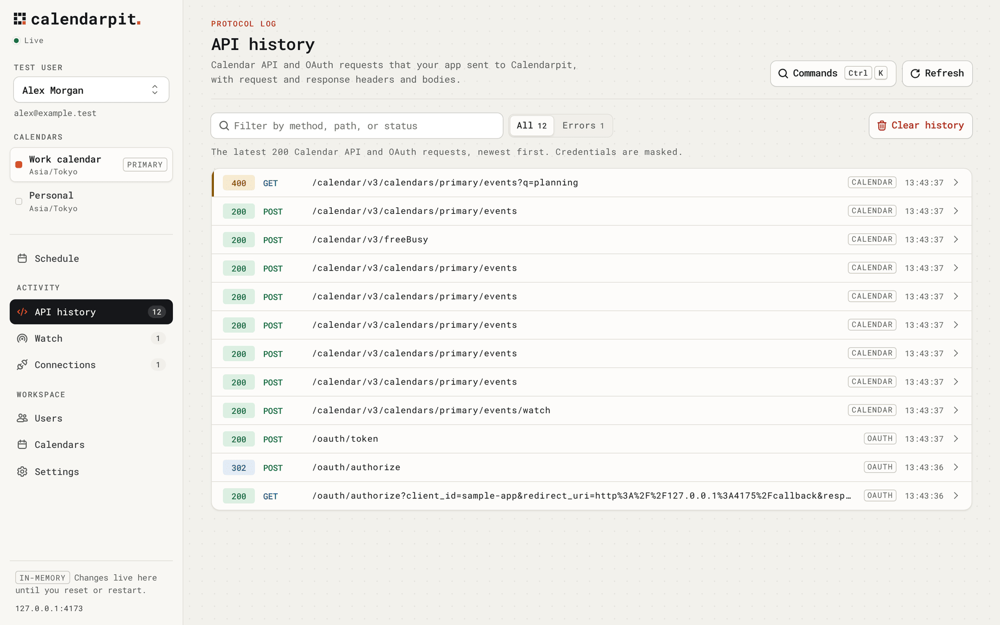
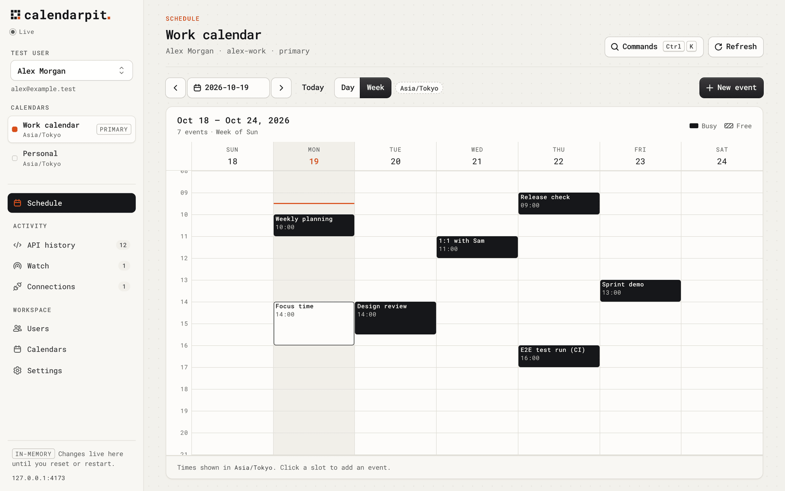

<h1>
  <picture>
    <source media="(prefers-color-scheme: dark)" srcset="apps/docs/src/assets/logo-dark.svg">
    
  </picture>
</h1>

An open-source local Google Calendar API and OAuth server for development and tests.

[](LICENSE)
[](https://github.com/iktakahiro/calendarpit/releases/latest)
[](https://github.com/iktakahiro/calendarpit/pkgs/container/calendarpit)

**[Website](https://calendarpit.dev/)** · **[Docs](https://calendarpit.dev/quick-start/)** · **[Dev.to](https://dev.to/iktakahiro/i-built-an-open-source-local-google-calendar-api-and-oauth-server-for-testing-ai-agents-and-mcp-4319)**

Calendarpit is a local server for testing calendar integrations, including AI
agents and MCP tools that call the Google Calendar API. A test uses local OAuth
and local calendar data, which takes the place of a real Google account, OAuth
test users, and live calls to Google.

https://github.com/user-attachments/assets/11db212a-89c9-4a04-8ff2-9711595e2f98

## What it does

- Calendar and event APIs compatible with a subset of Google Calendar API v3, including free/busy
- Local OAuth 2.0, with a consent page where you pick a test user
- Watch notifications delivered to a callback you control
- Fixtures and reset, so a run can start from the same data
- API history with credentials masked
- Optional Calendar API rate-limit simulation (`off` by default, `production`,
  or `error-test`) that returns Google's quota errors
- An admin UI on the same origin as the API, which shows changes as soon as the
  server saves them

Calendarpit is a preview before 1.0: the documented subset works locally, and
the API surface may still change. Supported methods are listed in
the [compatibility reference](https://calendarpit.dev/compatibility/).
Documentation is published in English and [Japanese](https://calendarpit.dev/ja/).



<picture>
  <source media="(prefers-color-scheme: dark)" srcset="docs/assets/admin-schedule-week-dark.png">
  
</picture>

## Quick start

With Docker:

```sh
docker run --rm \
  -p 127.0.0.1:4173:4173 \
  -v calendarpit-data:/data \
  ghcr.io/iktakahiro/calendarpit:latest
```

Or Homebrew:

```sh
brew install iktakahiro/tap/calendarpit
calendarpit serve
```

Open <http://127.0.0.1:4173>. The API, local OAuth, and admin UI share that
origin. No Google credentials, environment file, or external database is
needed. The latest release is also on
[GitHub Releases](https://github.com/iktakahiro/calendarpit/releases/latest).
[Installation](https://calendarpit.dev/installation/) covers Compose, standalone
downloads, networking, and updates.

## Connect your app

Point your Google SDK and OAuth flow at Calendarpit by overriding the
authorization, token, and Calendar API endpoints.
[Connect your app](https://calendarpit.dev/connect/) walks through that setup.
[SDK examples](https://calendarpit.dev/sdks/) cover TypeScript, Python, Go,
Kotlin, PHP, C#, and curl.

## Fixtures and test control

Save a fixture as `calendarpit.fixture.json`, then start from that directory:

```sh
calendarpit serve --database :memory: --config ./calendarpit.fixture.json
```

A relative fixture path resolves from the directory where you start the CLI.
Loading a fixture replaces current data. Reset restores the startup fixture and
clears credentials, history, and watch state. See
[Fixtures](https://calendarpit.dev/fixtures/) and the
[test control API](https://calendarpit.dev/test-control/).

## Docker Compose

Add this service to your project's `compose.yaml`:

```yaml
services:
  calendarpit:
    image: ghcr.io/iktakahiro/calendarpit:latest
    ports:
      - '127.0.0.1:4173:4173'
    volumes:
      - calendarpit-data:/data

volumes:
  calendarpit-data:
```

```sh
docker compose up -d calendarpit
docker compose logs calendarpit
docker compose down
```

Images are tagged `latest` and with each release version. Pin a version tag
when CI needs a fixed version.

The container binds `0.0.0.0` and runs as a non-root user. The host port stays
on loopback. The named volume keeps `/data/calendarpit.sqlite`;
`docker compose down -v` deletes it. Use `CALENDARPIT_DATABASE=:memory:` for a
disposable session. Browsers on the host use `http://127.0.0.1:4173`. Another
Compose service uses `http://calendarpit:4173`. OAuth and webhook networking
are in [Installation](https://calendarpit.dev/installation/).

## CLI

```sh
calendarpit --help
calendarpit --version
calendarpit serve --port 4173 --database :memory:
```

Homebrew and standalone downloads run the same executable. It includes the
server, admin UI, and Bun runtime. Calendarpit is not published to npm.
Releases target macOS arm64/x64, Linux glibc arm64/x64, and Windows x64. The
default bind address is `127.0.0.1`; pass `--host` to change it. CLI flags
take precedence over `CALENDARPIT_*` environment variables.
`--rate-limit` or `CALENDARPIT_RATE_LIMIT` sets the
[Calendar API rate-limit simulation](https://calendarpit.dev/running/#calendar-api-rate-limits).
See [Run and configure](https://calendarpit.dev/running/).

Homebrew and standalone CLI runs save to `.calendarpit/calendarpit.sqlite` in
the current directory. See
[Storage and restarts](https://calendarpit.dev/storage/).

## Built with

Bun, React 19, TanStack Start, TanStack Router, TanStack Query, TanStack Form,
Cloudflare Kumo, Tailwind CSS 4, and SQLite via `bun:sqlite`.

## Contributing

Setup, contributor commands, the Google SDK sample app (port 4175), and release
steps are in [docs/](docs/README.md). Start with the
[development guide](docs/development.md).

## License

Calendarpit is released under the [MIT License](LICENSE).
